# C06 · AI设计流水线 v1.1.0

专为**“零代码或追求极致效能的创作者”**打造的工业级端到端桌面软件生产与走查总控中枢。

本体系在 Antigravity 客户端内 **1:1 原生落地小米 AI 设计系统三代演进精髓**，将多 Agent 编排、环境隔离、无头自动化走查与经验自进化知识库完整固化为可调用的标准化工作流，并原生内置**上下文状态推断与单字符（? / n / r / p / b）零摩擦快捷键系统**。

---

## 核心架构与多 Agent 协作时序

```mermaid
sequenceDiagram
    autonumber
    actor User as 用户 (只需给点子、草图或单字符指令)
    participant Master as 流水线总控智能体 (Master)
    participant NodeScript as 无头渲染脚本 (screenshot.js)
    participant Critic as 独立走查子智能体 (Subagent · 干净上下文)
    participant Memory as 本地双知识库 (design_badcases.json)
    participant Pake as 本地打包引擎 (pake-cli)

    User->>Master: 1. 提交初始想法 / 拖入草图 (或在任何时刻输入 ?)
    Master->>Master: 2. 状态机自动推断当前阶段，提出反问或建议
    User->>Master: 3. 输入 [n] 确认推进
    Master->>Master: 4. 生成标准化《设计规格契约 (Design Spec)》
    
    Master->>Memory: 5. 自动检索历史 Badcase 负样本
    Master->>Master: 6. 结合 C02 规范与 kit/ 组件库生成高保真应用代码 (HTML/React)
    
    rect rgb(20, 24, 36)
    Note over Master,Critic: 【核心护城河：物理隔离上下文 · 红蓝对抗】
    Master->>NodeScript: 7. 执行后台静默渲染与真实高保真截图 (1280x800)
    NodeScript-->>Master: 产出真实渲染图 screenshot.png
    Master->>Critic: 8. 派发独立子 Agent，仅传入【Spec】与【渲染截图】
    Critic->>Critic: 9. 对照 16 项工业标准客观找茬
    alt 走查发现严重或中度缺陷 (Blocker / Major)
        Critic-->>Master: 打回结构化缺陷清单 (Punchlist)
        Master->>Master: 针对性修复代码，重新触发渲染
    else 走查达标放行
        Critic-->>Master: 签署质检放行许可
    end
    end

    Master->>Memory: 10. 触发 distill.js 将本次走查打回的教训沉淀入库 (自进化)
    Master->>Pake: 11. 执行 pake 一键编译为 Windows .exe 安装包
    Master-->>User: 12. 交付桌面软件产物、源码与全套走查报告
```



---

## 一、 智能引导与单字符快捷导航协议 (Copilot Guiding Protocol)

为了彻底消除长流程任务中的迷茫感，本技能内置**状态自感知引擎**与**单字符快捷键监听器**：

### 1. 自动状态机推断准则 (State Detective)
当用户唤醒技能或发送输入时，Agent 自动扫描上下文，判断处于以下哪个状态：
* **状态 0 (INIT)**：尚无《Design Spec》➔ **需求对齐期**；
* **状态 1 (SPEC_LOCKED)**：已有 Spec，但尚未生成代码 ➔ **代码待生成期**；
* **状态 2 (CODE_READY)**：代码已产出，但尚未无头走查 ➔ **走查待审查期**；
* **状态 3 (AUDIT_ISSUES)**：走查发现未清零缺陷 ➔ **打回修复期**；
* **状态 4 (AUDIT_PASSED)**：走查指标全部通过 ➔ **待蒸馏 / 待打包期**；
* **状态 5 (DONE)**：`.exe` 已生成交付 ➔ **交付完成期**。

---

### 2. 全局单字符快捷指令清单 (Single-Key Interceptor)

用户在对话框中仅输入以下单个字符或标点符号时，Agent 必须立即拦截并执行对应动作：

| 快捷输入 | 指令意图 | 触发动作与响应行为 |
| :---: | :--- | :--- |
| **`?`** 或 **`？`** | **全景状态与快捷菜单 (HUD)** | **立即输出【全景进度看板 + 当前阶段诊断 + 下一步具体建议 + 全局快捷按键清单】** |
| **`n`** | **下一步推进 (Next)** | **无需打字，直接自动采纳当前阶段的最优方案推进一步**（例：状态1敲n自动写代码；状态2敲n自动截图走查） |
| **`r`** | **重新找茬/重试 (Redo)** | **唤醒独立子 Agent 重新对当前界面进行 16 项严苛挑刺审查** |
| **`p`** | **一键打包 (Package)** | **跳过后续微调，立即调用本地 Pake 编译为 Windows `.exe` 桌面软件** |
| **`b`** | **查看避坑库 (Badcases)** | **打印本地已沉淀的 `design_badcases.json` 经验库规则** |

---

### 3. 当用户输入 `?` 或 `？` 时的标准输出规范 (HUD 抬头看板)

必须采用以下极简、醒目的结构化卡片格式，让用户随时看清全局并记住所有快捷键：

```text
┌────────────────────────────────────────────────────────┐
│ 📍 流水线全景进度：[阶段X/5: 当前阶段名称]              │
│    [✔ 1.需求对齐] ➔ [▶ 2.代码生成] ➔ [3.独立走查] ➔ [4.打包] │
├────────────────────────────────────────────────────────┤
│ 💡 当前状态诊断与下一步建议：                          │
│    • 诊断：[如：需求契约已锁定，已加载5项历史避坑规则] │
│    • 建议：输入 [n] 立即由 AI 生成高保真单文件应用代码 │
├────────────────────────────────────────────────────────┤
│ ⌨️ 全局单字符快捷键速查 (按键即走)：                   │
│  • [?] 或 [？]：查看此进度看板与快捷键菜单 (随时可用)  │
│  • [n] (Next)：直接采纳推荐方案，自动推进到下一步      │
│  • [r] (Redo)：打回重做 / 唤醒独立子 Agent 重新挑刺    │
│  • [p] (Package)：立即一键打包为 .exe 桌面应用         │
│  • [b] (Badcases)：查看本地沉淀的避坑经验库            │
└────────────────────────────────────────────────────────┘
```

---

### 4. 常规交互末尾的轻量导航胶囊 (Footer Capsule)
在流水线进行中的每一次常规回答末尾，均需附带一行低干扰快捷提示：
> 💡 *提示：输入 `?` 查看建议与快捷菜单 ｜ 输入 `n` 推进下一步*

---

## 二、 流水线执行 5 大核心阶段

### 阶段 1：事前需求对齐与草图解析（拦截防跑偏 · 渐进式密集表格向导）
* **协议动作**：主 Agent 严禁在第一轮直接生成代码，必须启动**渐进式高密表格问答向导（Progressive Dense-Table Probe Protocol）**。
* **核心禁令（最高铁律）**：
  1. **严禁一次性倾倒问题**：严禁把所有维度的表格一次性全抛给用户！必须严格**单步推进、一步一确认**；
  2. **严禁吃项缩水**：向用户展示选项时，必须直接从 `references/dense_catalog.md` 提取完整可选项，**绝不擅自压缩或删减**；
  3. **表格极度紧凑（Ultra-Dense 单屏尽览）**：排版必须精简冗余文字，控制在 3~4 列，确保每一个维度的完整备选项表格**能在用户一个视口屏内一览无余，无需上下疯狂滚轮翻页**；
  4. **明确推荐标注**：每张表格中必须显式标出 `[首选推荐]` 项，方便用户快速盲选。
* **标准 4 步渐进推进流程**：
  1. **步 1 · 页面骨架与主布局密集表**：
     - 若用户拖入草图，利用多模态视觉提取拓扑；若仅有文字，基于业务场景分析；
     - 输出 `dense_catalog.md` 中的【维度 A：页面骨架与主视窗布局全景表】（L01~L06）；
     - 标注推荐项，向用户提问并**立即停下等待用户回复**（如用户选择 `L01`）。
  2. **步 2 · 交互按钮与控件排布密集表**：
     - 接收到用户确认的布局后，输出【维度 B：交互按钮与控制排布全景表】（B01~B07）；
     - 说明各按钮类型、放置位置与排布方式（左对齐/右对齐/吸底/浮动），向用户提问并**停下等待用户确认**。
  3. **步 3 · 微动效与过渡全景密集表**：
     - 接收到按钮清单后，结合页面元素，从【维度 C：微动效与过渡全景资产库】（M01~M22 完整 22 种动效，覆盖 Roll, Count, Collapse, States, Shimmer, Beam, Spotlight, Magnetic, Tilt3D, Stagger 等）中，整理出与当前业务最匹配的高密动效菜单；
     - 明确动效触发机制（悬停/点击/初次渲染/更新）与体验价值，向用户提问并**停下等待用户点选**。
  4. **步 4 · 弹窗容器与品牌真理源密集表 (awesome-design-md)**：
     - 接收到动效选择后，输出【维度 D：弹窗与容器形态表】（O01~O07）与【维度 E：设计系统品牌真理源】（D01~D06，如 Linear 极客暗黑、Stripe 现代SaaS、Notion 人文米白）；
     - 用户确认后，信息完全闭环，立即调用 `references/spec_template.md` 格式化产出《设计需求规格契约 (Design Spec)》，并将状态机流转至 **状态 1 (SPEC_LOCKED)**。

### 阶段 2：经验知识库检索与高保真代码生成
* **协议动作**：在编写代码前，优先读取 `knowledge/design_badcases.json`。
* **执行步骤**：
  1. 读取历史踩坑清单（如单行文本截断、WCAG AA 4.5:1 对比度、Win32 0-65px 拖拽区域、空状态指引）；
  2. 将这些规则作为强制负样本约束注入生成上下文；
  3. 严格遵循 `C02-UI视觉设计` 规范，采用黑曜石/小米橙视觉，生成自包含的高保真单文件应用代码并写入临时工作区。

### 阶段 3：无头脚本真实截屏与独立子智能体走查（核心红蓝对抗）
* **协议动作**：彻底打破“AI既当运动员又当裁判员”的致命缺陷。
* **执行步骤**：
  1. 自动化截图：调用本地脚本执行无头浏览器截图：
     ```bash
     node scripts/screenshot.js <htmlPath> <outImagePath> 1280 800
     ```
  2. 派生独立子智能体 (`invoke_subagent`)：
     * **上下文隔离红线**：主 Agent 在派发子智能体时，**严禁传递任何历史思考链、Prompt 或开发借口**！
     * **子智能体 Payload**：仅传入《Design Spec》以及刚刚渲染出的 `screenshot.png` 绝对路径；
  3. 子智能体对照 `references/audit_checklist.md` 逐项核验；
  4. 若存在问题，输出打回 Punchlist 并返回主 Agent 修复；修复完成后再次走查，直至 100% 达标。

### 阶段 4：双库闭环蒸馏（让 Agent 越做越聪明）
* **协议动作**：对本次项目中被走查官打回的关键修改点进行经验沉淀。
* **执行步骤**：
  1. 调用蒸馏脚本：
     ```bash
     node scripts/distill.js <类别> <标题> <反面案例> <解决方案> <一句话通用规则>
     ```
  2. 自动更新 `knowledge/design_badcases.json`，确保下一次项目启动时该错误绝不重现。

### 阶段 5：桌面端一键编译出货
* **协议动作**：调用本地全局安装的 `pake-cli`，直接将网页产物打包为独立的 Windows 桌面客户端：
  ```bash
  pake <产物路径或URL> --name "<应用名>" --title "<中文标题>" --width 1280 --height 800 --transparent
  ```

---

## 三、 本地内置工具与脚本速查

| 工具文件 | 路径 | 核心能力 |
| :--- | :--- | :--- |
| **无头截图脚本** | `scripts/screenshot.js` | 基于系统 Edge 浏览器无头模式，毫秒级将本地 HTML 渲染并保存为 1280x800 高清截图 |
| **知识库蒸馏器** | `scripts/distill.js` | 将每次走查打回的修改点自动去重、序列化沉淀至本地知识库 |
| **设计避坑知识库** | `knowledge/design_badcases.json` | 预置长文本溢出、色彩对比度、拖拽防粘连等大厂工业级避坑经验 |
| **16项走查标准清单** | `references/audit_checklist.md` | 供走查子智能体核验的定标定量检查表 |
| **需求规格契约模版** | `references/spec_template.md` | 标准化结构输入模版 |

---

## 四、 典型触发方式
* “启动 /C06-AI设计流水线”
* 输入 `?` 或 `？`：查看进度诊断与快捷键速查表
* 输入 `n`：直接推进到下一步
* 输入 `p`：直接一键打包
