# C06 · AI设计流水线 v4.0.0-Industrial-Release

专为**“零代码或追求极致效能的创作者”**打造的工业级端到端桌面软件生产、工程治理与出货总控中枢。

本体系在 Antigravity 客户端内 **1:1 原生落地小米 AI 设计系统三代演进精髓与 oil-dev-skills 六大支柱**，将多 Agent 编排、环境隔离、无头自动化走查与经验自进化知识库完整固化为可调用的标准化工作流，并原生内置**上下文状态推断与单字符（? / n / N / r / p / b / g / w）零摩擦快捷键系统**。

---

## 核心架构与多 Agent 协作时序

```mermaid
sequenceDiagram
    autonumber
    actor User as 用户 (只需给点子、草图或单字符指令)
    participant Master as 流水线总控智能体 (Master)
    participant NodeScript as 无头渲染与L1探针 (screenshot.js)
    participant Reviewer as 走查审查员 (内置Subagent 或 DeepSeek via E06)
    participant Memory as 本地双知识库 (design_badcases.json)
    participant Pake as 本地打包与发布引擎 (pake.cmd)

    User->>Master: 1. 提交初始想法 / 拖入草图 / 发送指令 (或在任何时刻输入 ?)
    Master->>Master: 2. 状态机推断当前阶段，识别【新建 Greenfield】还是【存量 Brownfield】，静默自检运行环境
    User->>Master: 3. 输入 [n] 确认推进
    Master->>Master: 4. 生成标准化《设计规格契约 (Design Spec)》（含业务主体、主角与主行动）
    
    Master->>Memory: 5. 检索历史 Badcase 负样本（含伪操作、状态撕裂、暴力覆盖防护）
    Master->>Master: 6. 结合内置 kit/ 组件库、范围白名单 (scope-check) 与六大工程契约生成高保真应用代码 (HTML/React)
    
    rect rgb(20, 24, 36)
    Note over Master,Reviewer: 【最小有效四层分层验证体系 (L1 ➔ L4)】
    Master->>NodeScript: 7. 执行后台静默渲染与 L1 控制台零异常探针
    alt L1 运行时报错 (未捕获 JS 异常)
        NodeScript-->>Master: 报错拦截打回，无需看图，主 Agent 自行修正
    else L1 通过
        NodeScript-->>Master: 产出高清渲染图 screenshot.png
    end
    
    Master->>User: 8. 询问选择审查员: [1]内置子智能体(免费/看图) [2]DeepSeek(代码逻辑/时段优惠) [3]极速免审
    User-->>Master: 确认选择 (输入 1/2/3 或回车直接采纳推荐项)
    Master->>Reviewer: 9. 派发对应审查员进行 20 项找茬或代码逻辑审查（严格物理隔离上下文）
    alt 走查发现严重或中度缺陷 (Blocker / Major)
        Reviewer-->>Master: 打回结构化缺陷清单 (Punchlist)
        Master->>Master: 针对性修复代码，重新触发渲染验证
    else 走查达标放行
        Reviewer-->>Master: 签署质检放行许可
    end
    end

    Master->>Master: 10. 执行【文档防腐一致性巡检 (Doc Drift Probe)】，自动反向同步 Spec 与 DESIGN.md
    Master->>Memory: 11. 触发 distill.js 将本次走查教训沉淀入库 (自进化)
    Master->>Pake: 12. 自增语义化版本号 (SemVer)，生成 CHANGELOG.md，调用 pake.cmd 打包至 dist/releases/vX.Y.Z/
    Master-->>User: 13. 交付独立桌面客户端 (.exe)、Release Notes、源码快照与全套走查报告
```



---

## 一、 智能引导与单字符快捷导航协议 (Copilot Guiding Protocol)

为了彻底消除长流程任务中的迷茫感，本技能内置**状态自感知引擎**与**单字符快捷键监听器**：

### 1. 自动状态机推断准则 (State Detective)
当用户唤醒技能或发送输入时，Agent 自动扫描上下文，判断处于以下哪个状态：
* **状态 0 (INIT)**：尚无《Design Spec》➔ **需求对齐与工程模式识别期**；
* **状态 1 (SPEC_LOCKED)**：已有 Spec，但尚未生成代码 ➔ **代码待生成期**；
* **状态 2 (CODE_READY)**：代码已产出，但尚未无头走查 ➔ **走查与运行时验证期**；
* **状态 3 (AUDIT_ISSUES)**：走查发现未清零缺陷 ➔ **打回修复期**；
* **状态 4 (AUDIT_PASSED)**：走查指标全部通过 ➔ **文档巡检与蒸馏期**；
* **状态 5 (DONE)**：版本已归档，`.exe` 安装包已生成 ➔ **交付完成期**。

---

### 2. 全局单字符快捷指令清单 (Single-Key Interceptor)

用户在对话框中仅输入以下单个字符或标点符号时，Agent 必须立即拦截并执行对应动作：

| 快捷输入 | 指令意图 | 触发动作与响应行为 |
| :---: | :--- | :--- |
| **`?`** 或 **`？`** | **全景状态与快捷菜单 (HUD)** | **立即输出【全景进度看板 + 当前微步游标 + 4+1 核销状态 + 阻塞原因 + 下一步最小动作】** |
| **`n`** | **微步推进 (Next Micro-step)** | **推进当前页的下一个未完成向导微步 (S1~S5)**。若存在未决项或门禁 BLOCKED，坚决不盲目跳步，仅输出缺项与最小补全动作；在阶段 2~5 则自动推进至下一阶段。 |
| **`N`** | **下一页面 (Next Page)** | **仅当当前页 Q1~Q5 均达到 PASS / 合法 N/A / 签署 WAIVED 且 clearance 退出码为 0 时**，方可开启下一页面的需求向导。 |
| **`r`** | **重新找茬/重试 (Redo)** | **唤醒审查员（内置子Agent或DeepSeek）重新对当前界面进行 20 项严苛挑刺审查** |
| **`p`** | **一键发布出货 (Package & Release)** | **仅当所有页面均核销且代码分层走查放行后可用**。自增版本号，写入 CHANGELOG.md，调用 pake.cmd 编译出货 |
| **`b`** | **查看避坑库 (Badcases)** | **打印本地已沉淀的 `design_badcases.json` 经验库规则** |
| **`g`** | **项目长期治理 (Govern)** | **生成分支健康看板、扫描清理残留 Worktree 目录、死代码与规则瘦身报告** |
| **`w`** | **通道切换 (Track/Worktree)** | **在 Fast-track (主干就地敏捷演进) 与 Heavy-track (Worktree 并行隔离) 之间无感切换** |

---

### 3. 当用户输入 `?` 或 `？` 时的标准输出规范 (HUD 抬头看板)

必须采用以下极简、醒目的结构化卡片格式，让用户随时看清全局并记住所有快捷键：

```text
┌────────────────────────────────────────────────────────────────────────┐
│ 📍 流水线全景进度：[阶段1/5: 需求对齐] · 当前作用域: [Page ID: 页面名称]  │
│    [▶ 1.需求对齐] ➔ [2.代码生成] ➔ [3.分层走查] ➔ [4.文档巡检] ➔ [5.发布] │
│    ↳ 🔍 向导微步游标：[S1 骨架] ➔ [S2 数据] ➔ [S3 控件] ➔ [S4 动效] ➔ [S5 品牌] │
├────────────────────────────────────────────────────────────────────────┤
│ 💡 当前状态诊断与下一步建议：                                          │
│    • 规格核销：Q1[✔] Q2[✔] Q3[▶进行中] Q4[待开始] Q5[待开始]            │
│    • 门禁状态：[BLOCKED: Q3 缺少主行动确认 ｜ PASS: 退出码 0]           │
│    • 下一步最小动作：请在 B01~B12 选项表中确认本页唯一的 Primary CTA   │
├────────────────────────────────────────────────────────────────────────┤
│ ⌨️ 全局单字符快捷键速查 (按键即走)：                                   │
│  • [?] 看板   • [n] 下一步/微步   • [N] 下一页   • [r] 重审   • [p] 打包出货 │
│  • [b] 避坑库 • [g] 长期治理看板  • [w] 快慢通道切换 (Fast/Heavy)       │
└────────────────────────────────────────────────────────────────────────┘
```

---

### 4. 快慢通道分流机制 (Fast-track Bypass)
* **慢通道（完整流水线）**：涉及新功能界面、页面结构重构、新增弹窗与复杂组件时，必须跑完整 5 阶段流水线与 4+1 核销；
* **快通道（日常微调免走查）**：针对改法完全明确的日常小修（如修改文案、调整参数数量、删除指定孤立按钮、微调单个已定样式），**直接完成源码修改并交付，免去截屏走查与打包流程**，避免浪费 Token 和用户时间。

---

### 5. 中断分类与断点回弹栈 (Interrupt Classifier & Resume Guardrail)
在人机协同过程中，若用户因答疑、纠偏规范、修Bug或热更新Skill临时插话中断了向导进程，Agent 必须严格执行调用栈保护：
1. **中断五类属性化**：
   - `CLARIFY`（纯答疑/探讨）：不改变规格，解答后回弹原微步，规格不失效；
   - `AMEND`（修改已确认规格）：写入 delta，失效最早受影响微步及下游，从该步重跑向导；
   - `FIX`（紧急修Bug）：允许先处理紧急修复，触碰 Q1~Q5 按 AMEND 处理；
   - `META`（热更新Skill/工具链）：不计入项目进度，重新拉取规范后 rebase；
   - `RECOVER`（断点恢复）：从 `.c06/wizard_state.json` 恢复状态；
2. **严禁静默跃迁（不变量：没有回弹，就没有向前推进）**：
   - 插话处理完毕后的最后一段响应，**严禁自行推断跳转到后续步骤或直接生成代码**；
3. **强制输出轻量回弹戳 (Resume Stamp · 3 行标准格式)**：
   ```text
   > 📌 【主线断点回弹 · Resume】
   > • 恢复主线：[当前页面] ➔ [S1~S5 挂起微步名称]
   > • 挂起原因：已完成「插话事件说明」
   > • 续接动作：[输出该微步对应的密集选项表，等待用户决策]
   ```

---

## 二、 核心架构与工程治理三大基石

### 1. 存量项目强继承约束（Anti-reinvention）
在进入阶段 2 代码生成前，流水线自动判定项目场景：
* **全新从零创建 (Greenfield)**：遵循 C06 原生规范，初始化统一的 Design Tokens（黑曜石/小米橙）与 UI 组件基础库；
* **存量项目强继承 (Brownfield)**：
  1. **先扫描后落笔**：必须先扫描既有 `globals.css` / `tailwind.config` / `components/`；
  2. **零二次引入**：严禁自行引入第二套组件库、图标库或发明违背基调的独立样式；
  3. **变体优先**：现有组件样式不符时通过扩展 `variant` 属性实现，**严禁在页面各处使用 `!important` 粗暴覆盖共享组件**。

### 2. 前端六大工程治理硬契约
1. **业务对象先行**：禁止凭单个零散字段盲目拼接页面，必须先厘清数据实体与所有权；
2. **清理无效信息与伪操作**：删除不能落地的虚假 AI 图标与占位按钮，清除内部暴露的 UUID 或未翻译枚举；
3. **保证状态与作用域真实**：同一业务数据单一权威来源，禁止当前分页当全选，异步操作失败保留已输入上下文；
4. **组件与结构各归其位**：列表负责对比识别、详情负责完整展示、编辑器负责修改；
5. **样式与动效严格落地**：沿用已有组件 Token，动效时长和贝塞尔手感严格对齐基准；
6. **改源头并清理死代码**：重构公共组件时同步所有受影响文件，迁移完毕彻底删除旧废弃代码。

### 3. 最小有效四层分层验证体系 (Minimal Layered Verification)
* **L1 · 运行时控制台零异常 (Runtime Zero-Error)**：`scripts/screenshot.js` 自动捕获浏览器未捕获 JS 异常（`TypeError`、`ReferenceError` 等），有红字直接打回修正；
* **L2 · 核心交互与持久化契约 (State Persistence)**：核心增删改查动作必须对接 LocalStorage/IndexedDB 形成数据闭环，禁止空函数 `() => {}` 或纯 `console.log` 欺骗；
* **L3 · 物理隔离视觉与防呆走查 (Visual & Anti-patterns)**：独立子智能体按照 20 项标准严格审查；
* **L4 · 桌面运行时冒烟 (Desktop Smoke)**：编译为 `.exe` 后确保进程稳定拉起，无白屏崩溃。

### 4. 深度吸收 oil-dev-skills 六大工程支柱物理落地规范
本流水线将开源标杆 `oil-dev-skills` 的六大开发治理能力全面固化为物理机器门禁：
1. **Explore (代码探索与边界测绘)**：`codebase_map.json` 由 Gate 签名锁定 AST 符号与依赖，任务包强绑定 `codebase_map_sha`，代码库被外部污染或实体漂移时直接返回 Exit 34 熔断；
2. **Plan (物理契约与范围锁定)**：Spec 规范文件内置 `<!-- C06_SCOPE_START -->` 物理契约块，强制包含用户 User Ed25519 签名信封 (`action: SCOPE_CONFIRM`) 与唯一 Nonce，杜绝任务包篡改用户意图 (Exit 20/24 强拦截)；
3. **Delegate (分轨委托与权限最小化)**：
   * **`L0-A` (纯删除轨)**：只减不增 (lines_added === 0, lines_deleted > 0)，必须包含 AST 静态证明 `deletion_proof`；
   * **`L0-B` (静态微调轨)**：单文件改动且新增行数 <= 5 行，白名单扩展名，必须持有 Commander 颁发的短期有效租约 (`c06/l0-lease/v1`)；
   * **`L1` (全功能特性轨)**：完整多阶段与全门禁交付；
4. **Review (双重代码审查与真实 Diff 对账)**：双重审查回执 (`pre_review_receipt.json`, `code_review_receipt.json`)，强校验物理 Git 二进制 diff 的 SHA256 哈希与作者邮箱，杜绝走过场虚假走查；
5. **Govern (零信任单调因果链与防重放)**：Ed25519 纯内存验签 + JCS Unicode 代理项拦截 + 64KB 单行预检并发排他锁 (`.c06/nonce.lock`) + Merkle 因果账本单调时间戳 (`t01Pkg.iat <= doneTime <= merge.iat`)；
6. **Triage (生产级合规与出货打包)**：9 大核心治理门禁连续幂等零写入执行 + SemVer 自动递增与 CHANGELOG.md 维护 + `pake.cmd` 跨平台桌面客户端出货。

### 5. 33 项信任根全量强校验与零磁盘写防篡改准则
* **无降级强校验**：`gate-check.js --verify-all` 强制核验全部 33 项信任根 Ed25519 纯内存签名，严禁任何条件三元降级；
* **门禁零磁盘写污染**：所有门禁与审计探针在执行只读审查时绝对禁止修改工作区任何文件，实现 100% 幂等复验。

---

## 三、 流水线执行 5 大核心阶段

### 阶段 1：事前需求对齐与草图解析（5步满射向导 + 4+1 格规格核销门禁）
* **协议动作**：主 Agent 绑定 `Current Scope: Page [ID]` 启动单步渐进向导。为杜绝“Q2 数据字段变成孤儿”和“遗漏动效/容器/品牌”，阶段 1 必须且只能严格按顺序推进 **5 步满射向导（S1~S5 ➔ 1:1 映射 Q1~Q5 五格）**：
  1. **步 1 (S1) · 页面骨架与主布局密集表**（从 L01~L11 确定视口主角 Protagonist、声明网格单元跨度与固有比例 ➔ 产出 **Q1 几何拓扑**）；
  2. **步 2 (S2) · 数据模型与存储单真理源**（业务实体、字段列表、LocalStorage 唯一权威源 Key、空/加载/错误态 ➔ 产出 **Q2 数据实体**）；
  3. **步 3 (S3) · 交互控件与主行动排布表**（从 B01~B12 锁定视口唯一 Primary CTA，定义次要操作与五态 ➔ 产出 **Q3 交互控件**）；
  4. **步 4 (S4) · 微动效物理手感与降级表**（从 M01~M30 逐一为核心交互绑定物理手感与 reduced-motion 降级 ➔ 产出 **Q4 动效物理**）；
  5. **步 5 (S5) · 弹窗容器与品牌真理源表**（从 O01~O10 容器形态 + D01~D09 品牌 Token 与 WCAG 对比度 ➔ 产出 **Q5 容器品牌**）。

* **4+1 格规格核销单门禁 (Spec Clearance Matrix · 出处绑定防伪)**：
  在输出《Design Spec》或进入代码生成前，必须显式核销 4+1 格。严禁 Agent 自签代填！每一项必须具备明确的决策出处：
  ```markdown
  | 维度代码 | 维度名称 | 状态标识 | 决策来源与出处绑定 | 核心规范内容 |
  | :---: | :--- | :---: | :--- | :--- |
  | **Q1** | **几何拓扑** | [✔] | `[U-CONFIRMED]` (user#turn-N) | L01~L11 拓扑、网格跨度、固有比例无拉伸 |
  | **Q2** | **数据实体** | [✔] | `[U-CONFIRMED]` (user#turn-N) | 实体字段、LocalStorage 唯一权威源、空状态 |
  | **Q3** | **交互控件** | [✔] | `[U-CONFIRMED]` (user#turn-N) | 唯一 Primary CTA (B01)、行内与次要控件 |
  | **Q4** | **动效物理** | [✔] | `[U-CONFIRMED]` (user#turn-N) | M01~M30 动效绑定清单，或合法 `[N/A (客观无动效)]` |
  | **Q5** | **容器品牌** | [✔] | `[U-CONFIRMED]` (user#turn-N) | O01~O10 容器形态、D01~D09 品牌 Token、WCAG 对比度 |
  ```
  > **门禁物理契约**：
  > 1. **出处防自签与真实绑定**：`[U-CONFIRMED]` 必须能追溯到用户的显式确认（严格匹配 `user#turn-<id>` 或 `User Turn #N`，禁止前导零，有效轮次范围 1~100；若存在 `.c06/turns.jsonl` 账本则强校验 id 存在且 `role=user`；凡虚构轮次、前导零、未登记账本或自签直接返回退出码 14）；未获确认项保持 `[SYS-REC (Pending)]`；
  > 2. **豁免红线与 Q5 双覆盖**：Q1(几何) 与 Q5(品牌) **绝不允许豁免或 N/A (`waived` 或 `na`)**；代码交互页 Q2/Q3 **绝不允许 `waived` 或 `na`**；全页豁免直接拦截；Q5 标为 PASS 时必须显式声明非空 `assets` 且同时覆盖至少一个容器形态 (O) 与品牌 Token (D)，资产缺失、为空、为 null 或单维均返回退出码 10；
  > 3. **状态落盘与脚本裁决**：每次向导推进自动落盘至 `.c06/wizard_state.json`，符合 `references/wizard_state.schema.json` 契约，调用 `node scripts/clearance.js <page_id>` 退出码为 0 方可流转至 **状态 1 (SPEC_LOCKED)**。
* **产出契约**：调用 `references/spec_template.md` 生成《设计需求规格契约 (Design Spec)》，流转至 **状态 1 (SPEC_LOCKED)**。

### 阶段 2：经验知识库检索与高保真代码生成
* **协议动作**：读取 `knowledge/design_badcases.json`（注入包括 CASE-008~011 等关于伪操作、暴力覆盖、状态撕裂的避坑负样本）；
* **执行约束**：遵循存量强继承与六大工程契约，生成高保真应用代码，流转至 **状态 2 (CODE_READY)**。

### 阶段 3：代码范围硬阻断、无头截屏与审查员走查（核心红蓝对抗）
* **协议动作**：
  1. **代码范围物理硬阻断与敏捷分流 (Scope Guard · Exit Code 20~25/33/34)**：调用 `node scripts/scope-check.js --spec <specPath>`。严格基于 `git diff --name-status -z` 与 `git status --porcelain=v2` 扫描全状态变更，若触碰绝对禁改目录（如 `CORE_FORBIDDEN_FAST_TRACK`）或超出白名单范围，**直接返回退出码 20~25/33/34 硬拦截打回**，彻底杜绝 AI 越界修改系统基础设施；支持 L0-A/L0-B 敏捷分流与行级鉴权安全词扫描；
  2. **L1 静默探针拦截**：调用 `node scripts/screenshot.js <htmlPath> <outImagePath> 1280 800`（或 `--stdout-base64` 零写入探针），自动拦截控制台全量未捕获致命 JS 异常与 Promise 拒绝 (退出码 40/41)，生成高清截图；
  3. **审查员动态路由 (Reviewer Dispatch)**：主 Agent 弹出单选菜单（支持单键输入 1/2/3 或直接回车采纳推荐项）：
     * **`[1] (Recommended) 内置独立子智能体 (Local Subagent)`**：
       - **优势**：免费零额外 Token 账单；物理上下文隔离；支持 `screenshot.png` 真实视觉看图走查；
       - **执行**：派生独立子智能体 (`invoke_subagent`)，传入《Design Spec》与截图路径，按 20 项工业标准找茬。
     * **`[2] 本机 DeepSeek 深度逻辑审计 (via E06)`**：
       - **优势**：异构模型红蓝对抗，极擅长深挖伪操作、空指针隐患、状态撕裂与边界越界；
       - **成本与时段感知**：北京时间 00:30~08:30 自动标注 `[💰 闲时优惠]`，其余时段提示正常费率；
       - **执行**：通过 `E06-本机智能体委托` 调用 `run_local.py run --runner dsh --mode read --prompt "..." --json`，获取结构化打回清单并支持后续 `--session` 追问复查。
     * **`[3] 极速免审 (Bypass Review)`**：
       - **模式**：仅确认 L1 控制台零报错，跳过重型走查，秒级放行交付。
  4. **根因溯源修复协议 (Root Cause Trace Protocol)**：审查员返回结构化 Punchlist 缺陷清单。若缺陷涉及数据未持久化、状态撕裂或异步时序问题，**严禁在 UI 视图层贴局部补丁掩盖**，必须查清数据源头并全仓排查同类坏味道；修复达标放行后流转至 **状态 4 (AUDIT_PASSED)**。

### 阶段 4：文档巡检防腐与双库经验蒸馏
* **文档巡检 (Doc Drift Probe)**：检查代码实际呈现与《Design Spec》/ `DESIGN.md` 是否脱节，存在漂移时自动反向回写更新文档，确保文档与代码 100% 同步；
* **经验蒸馏**：调用 `node scripts/distill.js` 将走查打回的关键缺陷自动提取沉淀入 `design_badcases.json`。

### 阶段 5：版本发布、Changelog 沉淀与桌面打包出货
* **协议动作**：
  1. 按照语义化版本规范 (SemVer) 自动推断并递增版本号（Patch / Minor）；
  2. 自动汇总本次迭代从需求、走查到放行的记录，追加生成或更新项目根目录的 `CHANGELOG.md`；
  3. **环境适配打包**：在 Windows PowerShell 下优先调用 `pake.cmd`（规避 PowerShell 脚本执行策略拦截），将独立客户端归档至 `dist/releases/vX.Y.Z/`：
     ```bash
     pake.cmd <产物路径或URL> --name "<应用名>" --title "<中文标题>" --width 1280 --height 800 --transparent
     ```
     > *注：若提示命令未找到，流水线自动提示一键补全环境：`npm install -g pake-cli`。*
  4. 交付包含安装包、Release Notes、源码快照与审计截图的完整出货产物，流转至 **状态 5 (DONE)**。

---

## 四、 本地内置工具与资产速查

| 工具文件 / 门禁命令 | 路径 / 命令 | 核心能力 |
| :--- | :--- | :--- |
| **Gate 1 · 资产文档一致性** | `node scripts/gate-check.js --doc-drift` | 扫描真实 Skill 资产范围 (72项)、比例跨度与一致性，Exit 0 干净放行 |
| **Gate 2 · Gate-check 自检** | `node scripts/gate-check.js --self-test` | 25 项变异负样本与全覆盖单元测试，Exit 0 |
| **Gate 3 · 准出审查器自检** | `node scripts/clearance.js --self-test` | 13 项准出矩阵与防伪异常覆盖测试，Exit 0 |
| **Gate 4 · 范围检查自检** | `node scripts/scope-check.js --self-test` | 范围检查与边界探针单元测试，Exit 0 |
| **Gate 5 · 全局准出矩阵核销** | `node scripts/clearance.js --all` | 核销全页面 4+1 格规格核销单与用户签名出处，Exit 0 |
| **Gate 6 · T00 (L0-A) 任务验收** | `node scripts/scope-check.js --task .c06/tasks/T00/task_package.json` | 纯删除轨任务包与 AST 证明核验，Exit 0 |
| **Gate 7 · T01 (L1) 任务验收** | `node scripts/scope-check.js --task .c06/tasks/T01/task_package.json` | L1 特性任务包、Diff 字节哈希与邮箱对账，Exit 0 |
| **Gate 8 · T02 (L0-B) 任务验收** | `node scripts/scope-check.js --task .c06/tasks/T02/task_package.json` | 静态微调租约 (<=5行)、无敏感词、单文件样式修改核验，Exit 0 |
| **Gate 9 · 全量信任根强校验** | `node scripts/gate-check.js --verify-all` | 全量 33 处 Ed25519 签名纯内存验签 (无条件门槛 33)，Exit 0 |
| **资产与文档一致性探针** | `scripts/gate-check.js` | 自动校验 catalog 与 SKILL 资产范围、跨度比例解耦，内置 25 项负样本自检与 v2 状态迁移 |
| **4+1格规格核销机器门禁**| `scripts/clearance.js` | 校验 `.c06/wizard_state.json`，出处防伪与退出码硬阻断 (0/10/11/12/13/14)，支持 `--state` 寻址与 `--self-test` |
| **代码范围物理硬阻断探针**| `scripts/scope-check.js` | 基于 git diff/status 全状态扫描，触碰禁改目录或超出白名单直接返回退出码 20/21/22/23/24/25/33/34 硬阻断 |
| **无头截图与L1探针** | `scripts/screenshot.js` | 毫秒级生成 1280x800 截图，全量捕获拦截未捕获致命运行时异常与 Promise 拒绝 (退出码 40/41，支持 `--stdout-base64` 零写入) |
| **知识库蒸馏器** | `scripts/distill.js` | 将每次走查打回的修改点自动去重、序列化沉淀至本地避坑库 |
| **现成高保真组件库** | `kit/` | 内置 150+ 高保真 React/CSS 组件（Button/Card/Roll/Count/stageshow.css/ease.ts 等） |
| **设计与工程避坑库** | `knowledge/design_badcases.json` | 预置长文本溢出、色彩对比度、拖拽防粘连、去伪操作、防暴力覆盖等大厂工业级经验 |
| **20项走查标准清单** | `references/audit_checklist.md` | 供走查子智能体核验的定标定量检查表（含工程治理与数据真实性契约） |
| **需求规格契约模版** | `references/spec_template.md` | 结构化需求契约模版（含业务主体、主角、主行动、C06_SCOPE 物理契约块与生命周期定义） |
| **资产与文档一致性探针** | `scripts/gate-check.js` | 自动校验 catalog 与 SKILL 资产范围、跨度比例解耦，内置 25 项负样本自检（10/11/12/13/14/0）与 v2 状态迁移 |
| **4+1格规格核销机器门禁**| `scripts/clearance.js` | 校验 `.c06/wizard_state.json`，出处防伪与退出码硬阻断 (0/10/11/12/13/14)，支持 `--state` 寻址与 `--self-test` |
| **代码范围物理硬阻断探针**| `scripts/scope-check.js` | 基于 git diff/status 全状态扫描，触碰禁改目录或超出白名单直接返回退出码 20/21/22/23/24/25/33/34 硬阻断 |
| **无头截图与L1探针** | `scripts/screenshot.js` | 毫秒级生成 1280x800 截图，全量捕获拦截未捕获致命运行时异常与 Promise 拒绝 (退出码 40/41，支持 `--stdout-base64` 零写入) |
| **知识库蒸馏器** | `scripts/distill.js` | 将每次走查打回的修改点自动去重、序列化沉淀至本地避坑库 |
| **现成高保真组件库** | `kit/` | 内置 150+ 高保真 React/CSS 组件（Button/Card/Roll/Count/stageshow.css/ease.ts 等） |
| **设计与工程避坑库** | `knowledge/design_badcases.json` | 预置长文本溢出、色彩对比度、拖拽防粘连、去伪操作、防暴力覆盖等大厂工业级经验 |
| **20项走查标准清单** | `references/audit_checklist.md` | 供走查子智能体核验的定标定量检查表（含工程治理与数据真实性契约） |
| **需求规格契约模版** | `references/spec_template.md` | 结构化需求契约模版（含业务主体、主角、主行动、C06_SCOPE 物理契约块与生命周期定义） |

---

## 五、 典型触发方式
* “启动 /C06-AI设计流水线”
* 输入 `?` 或 `？`：查看进度诊断看板与快捷键速查
* 输入 `n`：直接推进到下一步
* 输入 `p`：直接自增版本、生成 Changelog 并一键编译桌面安装包
