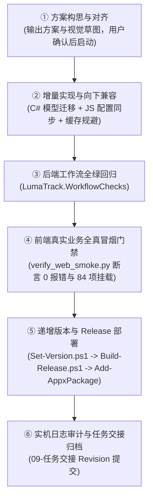

# 18 · Lucky_Note工作台迭代与体验护栏 v0.1.0

专属于 **Lucky_Note (LumaTrack)** 桌面分析工作台的迭代守门、体验护栏与架构顾问指南。

在执行功能迭代与界面优化时，强制遵循**“方案先行确认、苹果极简美学对齐、跨端双向握手契约、真实业务数据全量端到端无头冒烟门禁”**，彻底杜绝启动假死、列表归零、状态割裂与点击无响应等体验故障，并为用户提供持续的架构演进建议。

---

## 一、 触发场景与适用范围

当用户出现以下意图时，必须激活并严格遵循本 Skill：
1. **迭代功能**：“继续迭代 Lucky_Note”、“给工作台添加功能”、“修改路径/云编号/备忘录”、“新增代码工坊常用语段”；
2. **体验优化**：“页面有点卡”、“按钮位置不协调”、“希望界面更美观/更便捷”；
3. **故障排查**：“数据消失了”、“点击无响应”、“左侧抽屉显示为 0”、“白屏假死”；
4. **架构咨询**：“后台架构怎样更合理”、“怎样更先进”、“数据库或前端怎样优化”。

---

## 二、 第一原则：用户体验第一与四大零容错红线

用户的核心角色是**产品负责人（Product Owner）与资深生信分析师**，重点关注**流畅（60fps、秒启）、便捷（一键操作、清晰反馈）、美观（macOS HIG 极简质感）、功能完备**。底层技术细节由 AI 负责把控与守门。

### 🚨 四大交付死线（违背任意一条，严禁交付用户）
1. **【零容错启动】严禁冷启动假死或 0 数据假象**：
   - 软件启动后必须在 1 秒内全量渲染全部真实业务项目（84+ 个）；
   - 绝对不允许主视区停留在硬编码单项目（如 `N144` 演示兜底）或左侧抽屉各个分类全部显示为 `(0)`。
2. **【零破坏安全】底层业务数据库绝对完好**：
   - 本地核心数据库位于 `LumaTrack\data\app-state.json`；
   - 任何迭代绝不允许清空、篡改既有历史项目字段或引入破坏性反序列化错误。
3. **【方案先行法则】涉及交互与界面布局调整，必须“先出方案，确认后再改”**：
   - 严禁未经用户审阅直接重写核心 UI 布局；
   - 必须先向用户清晰说明设计方案、视觉预期（配合 ASCII 布局图或直观示意），待用户明确确认后再行动笔实施。
4. **【全真前端冒烟门禁】禁止仅靠 C# 后端测试通过就宣布交付**：
   - 严禁只运行 C# 单测就打包发布；
   - 必须通过内置无头浏览器脚本完成前端网页的全量端到端测试，确保控制台 0 报错、抽屉真实挂载。

---

## 三、 标准迭代生命周期（六步闭环）



### 步骤 1：方案构思与视觉对齐
- 听取用户诉求，结合业务场景（单细胞分析流程、项目凭证、售后沟通）；
- 给出明确方案（文字说明 + 布局草图），等待用户确认。

### 步骤 2：代码增量实现与跨端双向契约
1. **模型与迁移安全**：
   - 若新增字段，在 `Models/ProjectState.cs` 增加属性后，必须在 `Services/AppStateMigrationService.cs` 补齐向下兼容初始化；
2. **跨进程生命周期契约**：
   - C# 端：`MainPage.xaml.cs` 的 `MainPage_Loaded` 流程末尾必须显式调用 `await PushStateToWebViewAsync();`；
   - 网页端：`workbench_engine.js` 必须维持心跳重试握手，若未收到真实数据则持续向 C# 请求（每 300ms 一次，最多 50 次）；
3. **WebView2 防缓存**：
   - 导航 URL 递增：`workbench.html?v=X.Y.Z`；
   - 脚本引用递增：`workbench_engine.js?v=X.Y.Z`。

### 步骤 3：后端自动化测试回归
运行全量业务规则测试：
```powershell
& "E:\A002-Codex\工作区\tools\dotnet\dotnet.exe" run --project "E:\A002-Codex\工作区\LumaTrack.WorkflowChecks\LumaTrack.WorkflowChecks.csproj"
```
确保 Excel 导出、飞书导入、分析统计、v2/v3 工作流等全部全绿。

### 步骤 4：前端全真无头冒烟测试（质量门禁）
必须运行本技能内置的无头 Edge 自动化测试：
```bash
python scripts/verify_web_smoke.py <optional_screenshot_path>
```
**断言标准**：
- 控制台错误数（Console Errors）必须等于 `0`；
- 真实挂载项目数（Mounted Projects）必须 `>= 84`；
- 侧边栏抽屉卡片数（Drawer Elements）必须 `> 0`；
- 当前激活项目卡片必须成功显示标题与客户姓名；
- 若测试失败，**严禁构建发布**，必须就地修复。

### 步骤 5：递增版本与构建部署
1. 递增版本号：
   ```powershell
   powershell -ExecutionPolicy Bypass -File "E:\A002-Codex\工作区\LumaTrack\build\Set-Version.ps1" -Version X.Y.Z
   ```
2. 详细更新 `CHANGELOG.md`；
3. 编译打包：
   ```powershell
   powershell -ExecutionPolicy Bypass -File "E:\A002-Codex\工作区\LumaTrack\build\Build-Release.ps1"
   ```
4. 部署安装并启动：
   ```powershell
   Stop-Process -Name 'Lucky_Note' -Force -ErrorAction SilentlyContinue
   Add-AppxPackage -Path "E:\A002-Codex\工作区\LumaTrack\artifacts\msix\X.Y.Z-x64\LumaTrack_X.Y.Z.0_x64_Test\LumaTrack_X.Y.Z.0_x64.msix"
   Start-Process "$env:WINDIR\explorer.exe" "shell:AppsFolder\2C58692D-8BD7-417A-82AF-D61524576AD7_97k1ms176pkry!App"
   ```

### 步骤 6：审计验证与交接归档
- 检查本地诊断日志 `E:\A002-Codex\工作区\LumaTrack\data\logs\lucky-note-*.log`，确认新版本 `app.launched` 正常记录，无未捕获异常；
- 严格遵循 `09 · 任务交接` 提交中央交接记录 Revision。

---

## 四、 开放架构演进顾问职责（AI 主动提案指南）

AI 不受既有代码限制，被赋予“系统架构顾问”职责。在每次迭代过程中，应主动识别瓶颈并以“白话体验语言”向用户提请优化：

1. **存储演进**：向用户提议将单文件 `app-state.json` 演进为轻量嵌入式数据库（SQLite / LiteDB），降低读写 I/O 开销；
2. **代码解耦**：向用户提议将 7,200 行单文件 `workbench_engine.js` 拆分为高内聚组件（备忘录组件、详情卡片组件、话术工坊组件），实现异常隔离；
3. **秒开缓存**：向用户提议引入浏览器 IndexedDB 离线秒开缓存，消除任何等待感。
