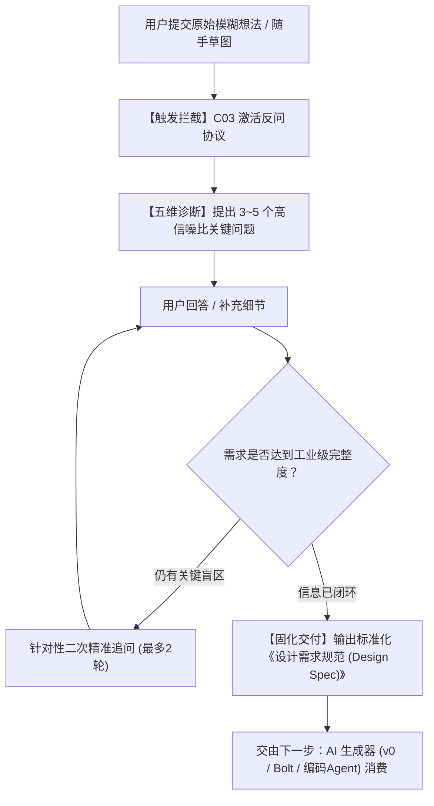

# C03 · 需求对齐追问 v1.0.0

借鉴**小米 AI 设计系统演进经验**（第一代到第二代的核心突破：**从自由输入转向事前需求对齐**）。

在 AI 辅助开发与设计链路中，**“人的输入天然不可控，信息往往充斥省略与模糊；AI 在缺乏关键约束时会自动脑补假设，导致生成严重跑偏”**。本技能作为生成链路的**首道拦截防线**，严禁在需求模糊时直接编写代码，必须通过结构化反问将用户的灵感抽象为确定性的工业级设计输入物。

---

## 核心执行流程



---

## 一、 反问拦截准则（严守三不原则）

1. **不假设不脑补**：用户未明确说明的业务流向、异常场景，严禁擅自假定，必须反问。
2. **不过载不冗余**：单次反问控制在 **3 ~ 5 个最核心的决策级问题**，绝不抛出一份长达20道题的调查问卷吓退用户。
3. **给选项降门槛**：针对每一个反问，**必须提供 2~3 个典型选项（含推荐选项）**，方便不懂技术的用户直接做选择题，而非填空题。

---

## 二、 五维结构化反问框架（The 5-Dimension Probe）

当用户抛出“帮我做一个记账App”、“做一个外贸跟单软件”等想法时，按以下五个维度组织追问：

### 1. 目标用户与核心场景（User & Scenario）
* *“这个软件主要给谁用？在什么具体情境下打开它？”*
* 选项参考：A. 个人快速记录（追求1秒内完成）；B. 专业团队/管理员（追求数据全面、报表筛选）；C. 客户或小白自用（追求大字体、操作简单零学习）。

### 2. 核心价值闭环与最小骨干（MVP Core Path）
* *“如果只能保留 3 个不可替代的核心功能，是哪 3 个？”*
* 引导用户收敛范围，剔除花哨的边缘功能，锁死第一版的核心骨架。

### 3. 信息结构与主视窗布局（Layout & Hierarchy）
* *“在电脑大屏上，你倾向哪种经典排版风格？”*
* 选项参考：
  * A. **左侧导航 + 右侧主工作区**（最经典耐看，适合管理类、笔记类、工具类）
  * B. **三栏式流水布局**（左侧列表 + 中间概览 + 右侧详情，类似飞书/邮件客户端）
  * C. **单屏看板/卡片式**（类似 Trello 看板，适合任务流转与灵感记录）

### 4. 关键边界与异常态（Boundary & Edge Cases）
* *“当软件第一次打开、没有任何数据时，界面上该显示什么？”*
* *“当网络断开、或者保存失败时，需要怎么提示用户？”*

### 5. 视觉调性与桌面偏好（Visual & Theme）
* *“界面的视觉调性倾向？”*
* 选项参考：A. 纯净极简（浅色，类似苹果原生/无印良品）；B. 极客暗黑（深灰/纯黑，适合夜间与长时间聚焦）；C. 科技商务（小米澎湃风，圆角适中、带微妙毛玻璃微质感）。

---

## 三、 标准化交付产物契约：《设计需求规范 (Design Spec)》

当用户答复后，C03 必须停止反问，并格式化输出以下结构化 Markdown 文档，作为下一步直接投喂给 AI 界面生成工具的最高输入物：

```markdown
# [项目名称] · 电脑端应用设计规格书 (Design Spec)

## 1. 核心定位与目标用户
- 定位：...
- 核心用户群：...

## 2. 界面骨架与交互流
- 布局模式：[如：左侧侧边栏(220px) + 顶部状态条 + 响应式中央工作区]
- 页面层级清单：
  1. [页面A]：包含模块与交互说明
  2. [页面B]：包含模块与交互说明

## 3. 数据与状态规范
- 初始空状态（Empty State）：显示引导文案与[立即创建]快捷主按钮
- 正常数据流：...
- 极端状态约束：单行文字过长截断并展示 Tooltip，列表超过 20 条分页/虚拟滚动

## 4. 视觉与交互规范
- 主题风格：[深色 / 浅色 / 自动跟随系统]
- 强调色（Accent）：[如：#0071e3 科技蓝 / #ff6900 小米橙]
- 圆角与间距：统采用 8px~12px 圆角，内边距遵循 8 点栅格体系 (8/16/24px)
```

---

## 四、 激活此技能的典型触发词
* “我有一个新点子，帮我做需求对齐”
* “帮我理一下这个桌面 App 的需求”
* “按小米第一代需求追问模式，反问我几个问题”
* `/C03-需求对齐追问`
