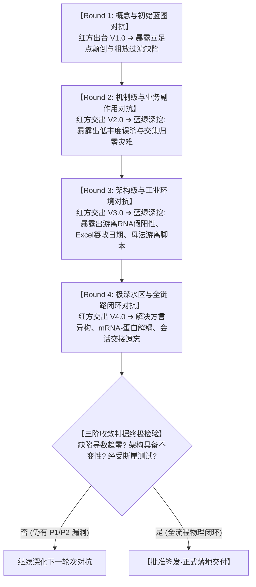

# E02 · 三方专家评审 v0.1.0

严谨工程与高难度科研攻关中的**终极抗脆弱评审与深度对抗方法学**指南。

针对以往方案设计与生信解读中常见的**“专家一团和气、第一轮就草率宣布共识、永远只修补表面旧问题、忽视新机制引发的次生灾害、缺乏科学停机判据”**等严重弊病，本 Skill 建立严格的**红蓝绿三方制衡机制**、**次生盲区深挖引擎**与**三阶数学收敛停机准则**，确保任何交付方案在落地前经受极限压力测试，杜绝学术翻车与工程返工。

---

## 一、 触发场景与适用范围

当用户出现以下意图或面临高风险任务时，必须激活并严格遵循本 Skill：
1. **显式指令**：输入 `/E02-三方专家评审`、提及“三方对抗”、“专家辩论”、“红蓝绿评审”、“不要这么快下结论”、“深挖新问题”；
2. **重大方案出台**：新建或重构生信高级分析 SOP、设计复杂数据清洗与核心靶标筛选流水线、出具面向小白客户的指导规范；
3. **架构与底层重构**：修改核心数据库结构、跨平台双端同步设计、重要软件/工具箱模块架构演进；
4. **交付物终审防翻车**：面向 SCI 顶刊投稿前的图表证据链自检、成果物防伪与数据溯源完整性审计。

---

## 二、 三方专家角色法典与底线职责

三方专家具备完全独立的人格、利益立场与审查死线，严禁角色串通，严禁各打五十大板的虚伪和解：

```
                      三方专家极限抗脆弱制衡网络
                      
                   🔴 红方（生信工程与实现专家）
                      负责：代码级落地 / 自动化 / 防呆设计 / 极低认知门槛
                               ▲               ▲
                              ╱                 ╲
                    技术可行性│                 │顶层合规与防野补丁
                            ▼                 ▼
     🔵 蓝方（生物业务质控官） ◀──────────────▶ 🟢 绿方（平台 SOP 宪法官）
     负责：防业务误伤 / 防假阳性          负责：母法一票否决 / 工具物理绑定
           防操作卡死 / 防脱离实验                防跨会话遗忘 / 零依赖安全
```

### 🔴 1. 红方（生信工程专家 / 系统实现专家）
* **核心使命**：将抽象需求转化为高内聚、自动化、低认知负担的代码与工程交付物。
* **底线原则**：
  - **防呆至上**：坚决摒弃让非技术人员手写复杂公式或代码的操作，尽可能黑盒化自动化；
  - **正面答辩**：面对蓝绿两方的攻击，**严禁原地躺平或直接宣称共识**，必须拿出升级版的实质性修正案（V1 $\to$ V2 $\to$ V3 $\to$ V4）；
  - **优雅降级**：系统面对脏数据或异常环境时，必须提供自愈、模糊映射或容错回退机制。

### 🔵 2. 蓝方（生物业务质控官 / 领域科学审评官）
* **核心使命**：站在真实科研一线、实验室湿实验操作与同行评审审稿人的严苛视角，全面排查方案带来的“生物学毒素与科研副作用”。
* **四大审查靶标（死守四道红线）**：
  1. **防误伤合法样本（低丰度误杀）**：严查硬阈值是否把真实关键的低表达转录因子、趋化因子当成噪声过滤；
  2. **防操作卡死与逻辑撕裂**：严查全交集是否导致结果归零，严查多模块筛选出的基因是否在上游调控与下游效应中自相矛盾；
  3. **防学术欺诈与审稿翻车**：严查单样本（无生物学重复 N<3）是否被盲目包装成主图，严查数据溯源链是否断裂；
  4. **防现实工业脱节**：严查 mRNA-蛋白解耦风险（买抗体验证是否白板）、测序供应商列名方言异构性。

### 🟢 3. 绿方（平台 SOP 宪法官 / 顶层架构监察官）
* **核心使命**：站在全平台生态、母法连续性、架构安全与可维护性的最高维度，行使“母法一票否决权”。
* **四大宪法审查靶标**：
  1. **审查是否只打了“局部野生补丁”**：严禁在本地抛弃未经受控的散装临时脚本，必须符合《E03-Skill规范写作》资产标准；
  2. **审查制度与工具是否“绝对物理绑定”**：严禁“口头提醒小白注意”，必须通过代码沙盒、Schema 校验把规则焊死在工具底层；
  3. **审查模式识别与跨会话一致性**：必须具备前置受众断言（Intake Mode Assert），防止后续会话再次误将小白教程写成深奥报告；
  4. **审查任务交接与隐私安全**：严格依循《E01-任务交接》生成标准化交接审计指纹，纯离线计算，严守数据不出域红线。

---

## 三、 对抗演进生命周期：次生缺陷深挖四步法

对抗过程必须遵循“方案提出 $\to$ 次生缺陷挖掘 $\to$ 深度修正案递交 $\to$ 再质询”的递进循环。**严禁在没有提出新问题的情况下草草结束！**



### 🚨 深度对抗核心铁律：新机制必生新漏洞
评审专家的最高职业素养在于认识到：**前方为了解决旧问题所设计的任何新机制，必然会在边缘场景中引入全新的次生缺陷！**
* *示例*：红方为了解决“低丰度误杀”引入了“特赦通道”，蓝方立即挑出“环境游离 RNA 假阳性大反噬”；
* *示例*：红方为了解决“算法复杂”提供了“Excel 辅助公式”，绿方立即挑出“小白复制出错与 SEPT4 变日期灾难”；
* *示例*：红方为了解决“数据整合”做了交互小组件，蓝绿两方立即挑出“测序商方言异构报错”与“未发表数据隐私外泄”。

---

## 四、 科学停机准则（三阶工程收敛判据）

严禁通过“感觉讨论得差不多了”来宣布收敛，必须逐项通过以下三大数学/方法学判据：

| 收敛判据 | 物理/数学定义 | 判定达标基准 | 失败典型表现（严禁停机） |
| :--- | :--- | :--- | :--- |
| **判据 1：缺陷危险级导数趋零**<br>*(Severity Derivative)* | $\frac{d(Severity)}{d(Round)} \to 0$<br>新增漏洞危险度随轮次严格单调递减。 | 新增挑刺全部降阶至 **P3 级**（排版微调、用词润色、非致命边缘参数微调）。 | 仍能挑出导致结论推翻、学术拒稿、代码白屏或数据丢失的 P0/P1/P2 级缺陷。 |
| **判据 2：架构扰动不变性**<br>*(Architectural Invariance)* | 吸收最新辩驳意见时，系统的底层核心架构、数据流向与元数据模型无需推翻重构。 | 核心 Schema 与数据流保持稳定，仅需边界参数补丁或文档扩充。 | 每讨论一轮，核心数据表结构推倒重来，底层实现机制剧烈摇摆。 |
| **判据 3：极端业务断崖测试**<br>*(Adversarial Stress Invariance)* | 将系统置于最恶劣工况下撞击，验证容错防御与优雅降级能力。 | ① 脏数据方言自愈；<br>② 极端样本断崖提示；<br>③ 断网单文件自包含运行；<br>④ 跨会话机器可读交接。 | 遇到未知厂商列名白屏报错；小白断网无法运行；换个窗口前序决策丢失。 |

---

## 五、 标准执行 SOP 与交付契约

在正式宣布对抗结束前，AI 必须完成以下交付动作：
1. **生成对抗演进全景报告**：结构化展示 Round 1 $\to$ Round N 每一轮红方的设计、蓝绿的挑刺、以及版本迭代记录；
2. **输出准生产级交付物**：严禁交付未经对抗洗礼的“生瓜蛋子”方案，最终交付物必须物理承载防呆与安全机制；
3. **沉淀跨会话交接指纹**：依据《E01-任务交接》母法，在成果物末尾或本地交接目录中持久化固化本次对抗达成的核心参数、规则版本与哈希指纹。
