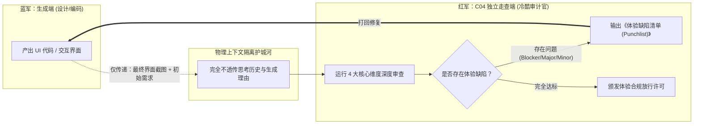

# C04 · 独立体验走查 v1.0.0

借鉴**小米 AI 设计系统演进经验**（第二代至第三代的核心踩坑复盘：**破除“AI既当运动员，又当裁判员”的认知幻觉**）。

如果让生成代码的同一个对话窗口或同一个 Agent 去自我检查，大模型会因为共享了“推导历史与心路历程”，陷入**证实偏差（Confirmation Bias）**，老觉得自己做得完美无缺。本技能建立在**严格的上下文隔离（Context Isolation）**原则上：**作为完全独立的“红军质检官”，绝不带任何主观宽容，纯粹对照最高工业级体验标准给界面无情挑刺。**

---

## 核心工作流与红蓝对抗



---

## 一、 核心输入契约（Input Payload）

走查 Agent **只接收两样东西**：
1. **当前界面的高清截图**（或者可直接交互的网页/客户端运行状态）；
2. **最初的《设计需求规格 (Design Spec)》**。

*严禁向本技能解释“为什么要这么设计”或“技术有什么难点”，走查官只看最终呈现结果，像最挑剔的真实终端用户一样严格审查。*

---

## 二、 桌面端 4 大维度 16 项严苛走查清单 (Audit Checklist)

### 维度 1：视觉层次与版式呼吸感（Visual Hierarchy）
- [ ] **信息层级分明度**：一眼看去是否能在 3 秒内抓到第一视觉焦点？是否存在“满屏都是重点 = 没有重点”的现象？
- [ ] **对齐与网格严格性**：元素间距是否统一遵循 8 点栅格（8px, 16px, 24px）？是否有肉眼可见的 1~2px 错位？
- [ ] **字体与对比度（WCAG AA）**：次要文字与背景的对比度是否达到 4.5:1？是否存在“浅灰底配更浅灰色文字”导致看不清？
- [ ] **克制与纯净度**：是否出现了大量毫无意义的装饰图标、非语义渐变色或廉价的“AI塑料感”？

### 维度 2：桌面应用特有交互机制（Desktop Interaction）
- [ ] **鼠标微交互（Hover & Active）**：所有可点击的按钮、卡片、列表项，鼠标悬停时是否有丝滑的背景加深或微动效反馈？
- [ ] **点击热区（Touch Area）**：小图标、关闭按钮的实际点击判定区域是否至少达到 $24\times24\text{px}$（防手滑误触）？
- [ ] **右键与快捷操作**：关键区域是否具备符合电脑操作习惯的辅助交互？
- [ ] **窗口自适应与多分辨率**：当窗口横向拉宽或缩小到 $1024\times768$ 时，内容是否会诡异变形或出现丑陋的水平双滚动条？

### 维度 3：状态完整性闭环（State Completeness）
- [ ] **空状态体验（Zero Data / Empty State）**：没有数据时，是否有生动的插画/引导语？主操作按钮是否直接指引用户第一步做什么？
- [ ] **加载与骨架屏（Loading State）**：数据加载时是否有平滑的骨架屏（Skeleton），避免突然白屏造成焦虑？
- [ ] **极端溢出测试（Stress Test）**：当用户输入的标题长达 100 个字、或输入一连串英文字母不换行时，界面会不会撑爆撑炸？

### 维度 4：文案与认知摩擦（Cognitive Friction）
- [ ] **操作可逆性（Safety Net）**：删除、清空等危险操作是否有一步确认（Modal 弹窗）或 Undo 撤销条？
- [ ] **专业术语降维**：文案是否说的是“人话”，杜绝系统底层报错（如抛出 `NullPointerException` 或未捕获代码）。

---

## 三、 标准化交付产物：《体验缺陷走查清单 (UI/UX Punchlist)》

C04 审查完毕后，必须输出标准化缺陷清单，明确标出严重程度与改法，方便用户直接复制发给 AI 工具修改：

```markdown
# 🔍 体验走查审计报告 (UI/UX Audit Report)

## 总体健康度评分：[72 / 100]

---

### 🚨 严重阻碍（Blocker - 必须立即整改）
1. **[位置/模块]：** 标题文字长文本溢出撑破左侧边栏
   - **痛点描述：** 当输入超过 15 个汉字时，文本溢出至右侧工作区，重叠遮挡了主新建按钮。
   - **修改方案/直接喂给AI的代码Prompt：** `“给所有侧边栏卡片标题添加 CSS：truncate (overflow: hidden; text-overflow: ellipsis; white-space: nowrap;) ，并在鼠标悬停时展示原生 tooltip 完整内容。”`

---

### ⚠️ 体验缺陷（Major - 强烈建议优化）
1. **[位置/模块]：** 次级辅助说明文字对比度过低
   - **痛点描述：** 灰色标签文字颜色为 `#c0c0c0`，在浅白背景下几乎不可见，违反 WCAG AA 标准。
   - **修改方案：** `“将所有辅助文字颜色由 text-gray-300 加深为 text-gray-500 (#6b7280)。”`

---

### 💡 润色建议（Minor - 精益求精）
1. **[位置/模块]：** 主按钮缺少鼠标悬停反馈态
   - **修改方案：** `“主操作按钮添加 hover:opacity-90 active:scale-95 transition-all 微交互动效。”`
```

---

## 四、 激活此技能的典型触发词
* “帮我以客观走查官视角审查这个界面截图”
* “用小米事后走查机制给这个产品挑刺”
* “进行 UI/UX 体验走查”
* `/C04-独立体验走查`
