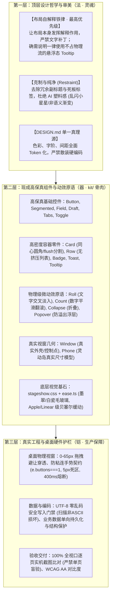
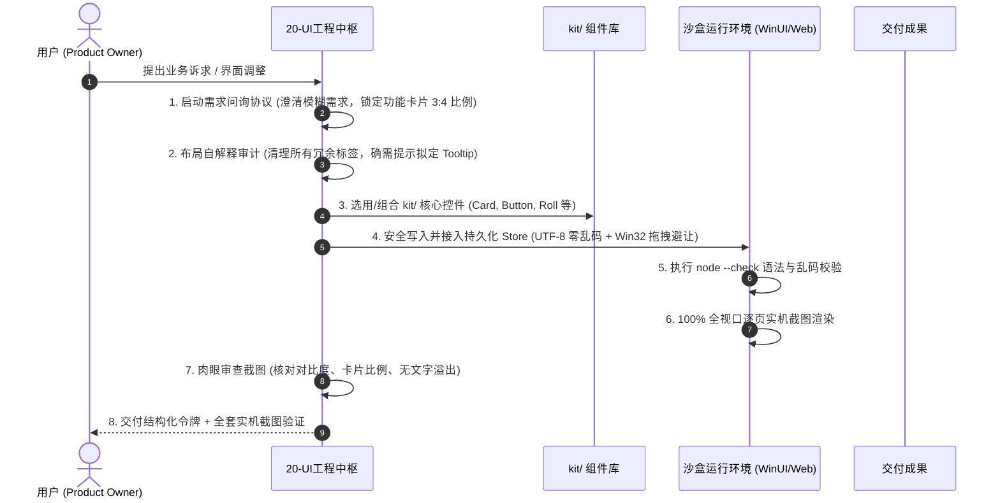

# C02 · UI视觉设计 v1.0.0

面向**现代桌面工作台（如 Lucky_Note / WinUI 3 + WebView2）**与**现代 Web 应用**的工业级 UI 设计、高保真组件开发与全流程工程交付中枢。

本体系将**“顶层极简自解释设计哲学（法）”**、**“现成底层高保真 React/CSS 组件库（器 · kit/）”**与**“桌面端 Win32 硬件安全门禁（铠）”**深度融合，彻底终结以往“原型漂亮落地走样”、“反复手写 CSS 导致样式变形与 Bug 堆积”、“文字标签堆砌掩盖不良布局”、“修改新功能导致旧特性丢失或桌面卡死”等顽疾，实现**设计即代码（Design-as-Code）全双工生产闭环**。

---

## 一、 核心架构：三层统一体系



---

## 二、 核心哲学与不可逾越铁律（Ironclad Guardrails）

> [!IMPORTANT]
> **【最高优先级·布局自解释与极简设计铁律】**
> **“避免不必要的辅助标签和说明。让布局本身发挥解释作用。如果有确实需要的地方，可以用悬浮态 tooltip 方式展示”** —— **此铁律优先级最高！**
> 严禁在界面中堆砌无意义的副标题、辅助角标或说明段落。必须依靠纯正的网格、比例、对比度与组件形态让界面自发传意。

### 0. 布局自解释与极简信息门禁（Layout-as-Explanation）
* **拒绝文字补丁**：好的界面如同一首诗，无需注释即可理解。严禁通过在卡片下方增加“请在此处点击添加”、“本模块用于显示进度”等文字来掩盖不合理的布局；
* **悬浮态 Tooltip 优雅承载**：若遇到确实需要向用户解释的复杂生信专业指标、特殊计算公式或操作提示，**一律采用悬浮态 Tooltip**（配合精致墨翠/纯白毛玻璃与冷暖边缘光，见 `kit/parts/Tooltip.tsx`），鼠标移开即消失，绝不挤占主界面的实体物理文档流。

### 1. 组件物理比例锁定原则（Intrinsic Functional Ratio）
* **画布自适应流式响应**：全局背景与画布保持 100% 视口流式铺开，允许高分辨率壁纸与毛玻璃呼吸；
* **功能组件比例严格锁定**：对于需求卡片（Macaron）、管线看板（Pipeline）等具有固定信息密度的组件，**必须显式锁定其功能物理比例（默认 3:4 黄金竖卡比例，如 `aspect-ratio: 3 / 4`）**，宽屏下自动换行或居中，绝不随窗口横向拉伸变形为扁平长条。

### 2. 优先复用内置 `kit/` 组件库（严禁重复手写野蛮 CSS）
* 本 Skill 内置了完整的 `kit/` 目录（包含 React+CSS 高保真组件源码）。在开发新界面或重构时，**必须优先从 `kit/` 中调用或参考其成熟的几何与 CSS 变量**，禁止随意手写零散、无规范的内联样式；
* 按钮必须使用 `kit/controls/Button`（自带尺寸与图标动画），卡片必须使用 `kit/parts/Card`（严格锁定内圆角与外圆角同心率），分段选择器必须使用 `kit/controls/Segmented`。

### 3. 桌面视窗硬件安全隔离（Desktop Physics Guardrail）
针对 WinUI 3 + WebView2 等桌面宿主，施加最高级别硬件安全防线：
* **顶栏 0~65px 拖拽避让**：保留为 Win32 原生拖拽区，内部按钮显式 `stopPropagation`；
* **防粘连手势契约**：严格限定 `e.buttons === 1`、5px 移动死区与 400ms 熔断机制，禁止 Chromium 子进程吞噬 `WM_LBUTTONUP` 导致光标跟随粘死；
* **60fps 与秒启**：DOM 深度严格控制在 4 层以内，微交互仅使用 GPU 加速属性（`transform`, `opacity`）。

### 4. UTF-8 零乱码写入与语法双检门禁
* 修改前端文件严禁使用 Windows 默认 ANSI/GBK 编码处理；
* 每次写入后必须扫描杜绝 `馃|锛|銆|鉁|鈥` 等乱码字符，并执行 `node --check <file.js>` 确保 0 语法错误。

### 5. 全视口 100% 逐页实机截图比对门禁（拒绝单页盲验）
* 当重构涉及多个子页面或视口时，**严禁只截取主页就宣称完成**；
* 必须对全部受影响的子页面逐一截取真实渲染图，Agent 必须调用 `read_file` 亲自肉眼走查对比度与布局，验证通过后方可交付。

---

## 三、 内置 `kit/` 组件库速查表

组件库源码位于本 Skill 的 `kit/` 目录，开箱即用：

| 模块分类 | 核心组件 | 源码路径 | 核心能力与适用场景 |
| :--- | :--- | :--- | :--- |
| **交互控件** | `Button` | `kit/controls/Button.tsx` | 5 种商业级变体，内置图标伸缩与文字 Roll 交叉淡入动画 |
| | `Segmented` | `kit/controls/Segmented.tsx` | Apple 级分段选择器，滑块带物理平滑惯性 |
| | `Field` / `Draft` | `kit/controls/Field.tsx` | 高密度输入框与草稿编辑区，内嵌状态指示 |
| | `Tabs` / `Toggle` | `kit/controls/Tabs.tsx` | 现代化选项卡与滑动开关 |
| **容器零件** | `Card` | `kit/parts/Card.tsx` | 内外圆角严格同心，支持 `flush` 细线分割与 `lift` 柔和投影 |
| | `Row` | `kit/parts/Row.tsx` | 高密度列表行，文字与徽标垂直居中对齐，防文字截断 |
| | `Tooltip` | `kit/parts/Tooltip.tsx` | 承载补充说明的免占位浮层，落实“布局自解释”的核心武器 |
| | `Toast` | `kit/parts/Toast.tsx` | 右上角/右下角多条折叠层叠通知，带自动倒计时销毁 |
| | `Badge` / `Chip` / `Kbd` | `kit/parts/` | 状态药丸、标签与键盘快捷键微组件 |
| **微动效原语** | `Roll` | `kit/motion/Roll.tsx` | 文字或内容原地平滑交叉淡换（例如：Save -> Saved） |
| | `Count` | `kit/motion/Count.tsx` | 数字平滑滚动累加动画（Ticker 效果） |
| | `Collapse` / `Expand` | `kit/motion/Collapse.tsx` | 根据子元素自然高度自适应平滑折叠展开 |
| | `Popover` | `kit/motion/Popover.tsx` | 智能根据视口边界计算翻转位置，防止被窗口裁切 |
| **视窗框架** | `Window` | `kit/window.tsx` | 拟真桌面视窗外壳，带标准三色控制点与毛玻璃衬底 |
| | `Phone` | `kit/phone.tsx` | 移动端设备框与灵动岛真实尺寸模型 |
| **样式与动效** | `stageshow.css` | `kit/stageshow.css` | 墨翠/纯白毛玻璃、高精度阴影、字阶与 Token 变量 |
| | `ease.ts` | `kit/ease.ts` | Apple/Linear 级贝塞尔缓动曲线算法 |

---

## 四、 商业级开发交付四阶段工作流



### 阶段 1：需求澄清与自解释布局规划
* 遇到模糊需求，依据专业词库（Surfaces、Materials、Motion）向用户做选项式问询；
* 坚守“布局自解释”：排布清晰网格，删除一切解释性文字补丁，将必要提示规划至 Tooltip。

### 阶段 2：组件选型与装配（调用 `kit/`）
* 根据需求组合 `kit/parts/Card`、`kit/controls/Button` 与 `kit/motion/Roll`；
* 严格锁定功能卡片的黄金物理比例（3:4）。

### 阶段 3：工程落地与系统硬件适配
* 注入桌面硬件防护（0-65px 拖拽避让穿透，手势防粘连）；
* 挂载业务数据层（IndexedDB / 本地文件），确保数据单向流动与自动保存；
* 全程 UTF-8 安全写入，通过 `node --check` 语法与乱码扫描。

### 阶段 4：全视口实机截图审查与交付
* 启动无头浏览器对每一个受影响视口逐一截屏；
* Agent 亲自读取截图验证无障碍对比度（WCAG AA 4.5:1）与视觉质感；
* 输出标准交付令牌与内嵌截图。

---

## 五、 交付证据令牌规范

交付 UI 设计、界面美化或重构成果时，必须输出以下结构化交付令牌：

```markdown
### 💎 现代化 UI 设计与高保真工程交付令牌
* **目标运行环境**：[Desktop (WinUI 3 + WebView2) / Modern Web]
* **布局自解释门禁 (最高优先级)**：[通过：0 冗余辅助说明标签，全部必要解释均收敛至悬浮态 Tooltip]
* **功能组件比例锁定**：[通过：核心卡片严格锁定 3:4 黄金物理比例，宽屏流式铺开不扁塌]
* **组件库复用 (kit/)**：[已复用 kit/ 标准原语：Card, Button, Segmented, Roll]
* **桌面视窗硬件门禁**：[0-65px 拖拽避让已锁定 / 0 粘连死锁 / 0 消息吞噬]
* **编码与语法门禁**：[全文 UTF-8 0 乱码 / node --check 0 报错]
* **全视口实机截图走查**：[N/N 页面 100% 实机截图比对通过，对比度符合 WCAG AA]
```
